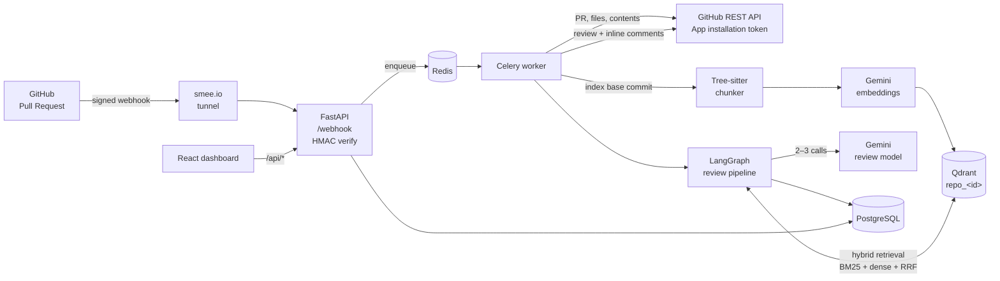
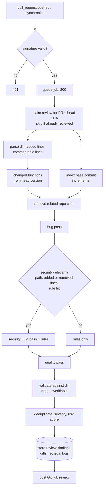
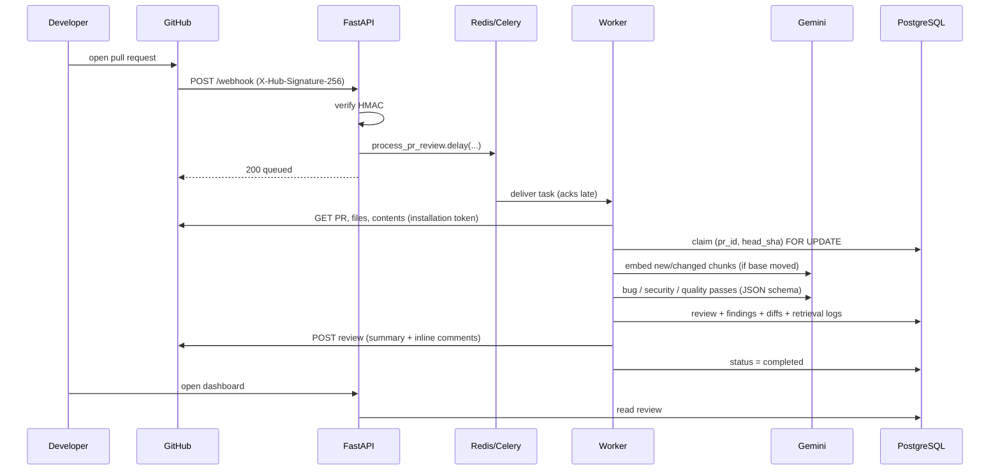
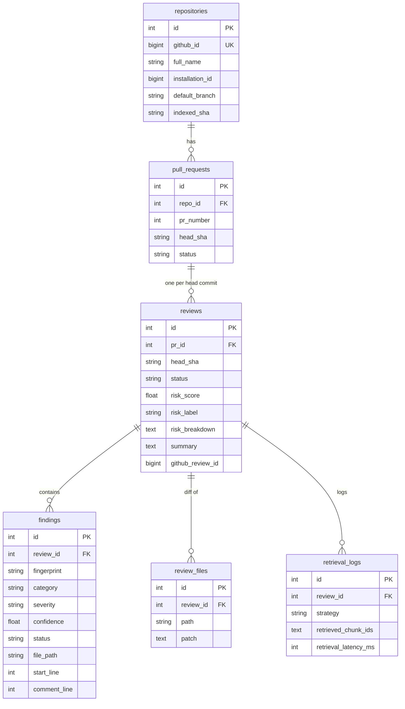

# Diagrams

GitHub renders these Mermaid diagrams directly. For slides, paste them into
https://mermaid.live and export PNG/SVG.

## 1. System architecture

## 2. Data flow of one review

## 3. Sequence

## 4. Database (ER)

Unique constraints: `pull_requests(repo_id, pr_number)`, `reviews(pr_id, head_sha)`
(idempotency), `findings(review_id, fingerprint)`, `review_files(review_id, path)`.
